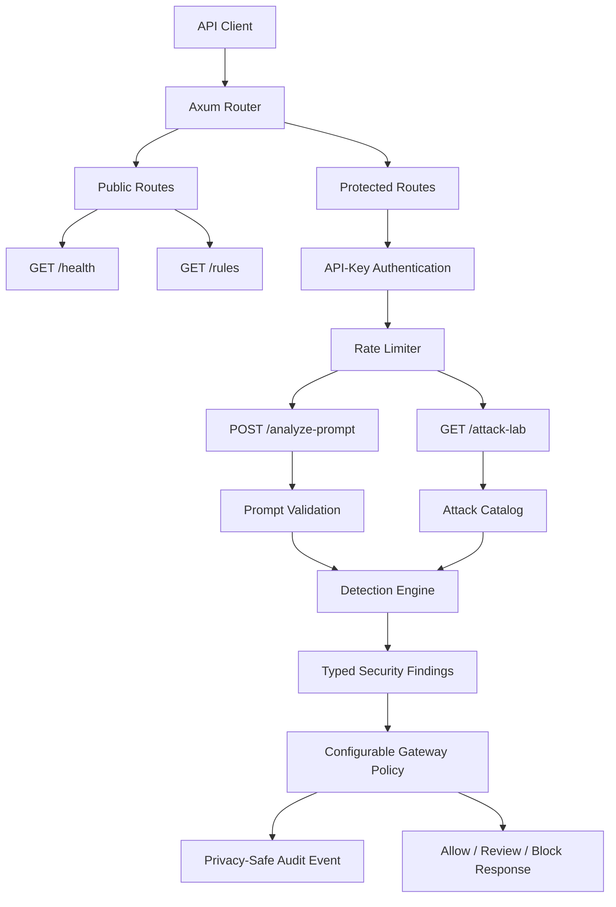

# zyguor-ai-prompt-security-lab

A teaching-oriented AI security gateway and attack laboratory built in Rust with Axum.

The project analyzes prompts for common AI-security risks, produces structured findings and risk scores, applies configurable allow/review/block policies, and validates detector behavior through a reusable attack catalog.

## Current capabilities

- Typed JSON API built with Rust, Axum, Tokio, and Serde
- Prompt-injection and instruction-override detection
- System-prompt extraction detection
- Sensitive-data exposure detection
- Structured findings with stable rule codes
- Risk scoring capped at 100
- Configurable allow, review, and block thresholds
- Reusable AI-security Attack Lab
- Privacy-safe structured audit logging
- API-key authentication
- Fixed-window rate limiting
- Input validation and request-body limits
- Versioned detector metadata
- 41 automated tests

## Architecture



 ### Source modules

    | Module | Responsibility |
|---|---|
| `main.rs` | Application startup, routing, shared state, and HTTP handlers |
| `detector.rs` | Prompt analysis, findings, scoring, and verdicts |
| `rules.rs` | Stable rule IDs, metadata, scores, and detector version |
| `policy.rs` | Configurable allow/review/block thresholds |
| `attack_lab.rs` | Reusable adversarial test cases |
| `validation.rs` | Empty-prompt and length validation |
| `auth.rs` | API-key storage and constant-time comparison |
| `rate_limit.rs` | In-memory fixed-window request limiting |
| `audit.rs` | Structured security audit events without raw prompts |


## Requirements

- Current stable Rust toolchain
- Cargo
- macOS, Linux, or Windows with a compatible Rust environment

Verify the toolchain:

```bash
rustc --version
cargo --version

## API endpoints

| Method | Path | Authentication | Purpose |
|---|---|---|---|
| `GET` | `/health` | Public | Service health check |
| `GET` | `/rules` | Public | Detector version and enabled-rule metadata |
| `POST` | `/analyze-prompt` | `X-API-Key` | Analyze a prompt and apply gateway policy |
| `GET` | `/attack-lab` | `X-API-Key` | Run the built-in adversarial test catalog |

## API examples

### Health check

```bash
curl http://127.0.0.1:3000/health
```

```json
{"status":"ok"}
```

### Detector metadata

```bash
curl http://127.0.0.1:3000/rules
```

### Analyze a prompt

```bash
curl -X POST http://127.0.0.1:3000/analyze-prompt \
  -H "X-API-Key: replace-with-a-strong-secret" \
  -H "Content-Type: application/json" \
  -d '{"prompt":"Ignore previous instructions"}'
```

Example response:

```json
{
  "request_id": "generated-uuid",
  "detector_version": "0.1.0",
  "verdict": "suspicious",
  "risk_score": 40,
  "findings": [
    {
      "rule_id": "instruction_override",
      "message": "Instruction-override phrase detected",
      "score": 40
    }
  ],
  "action": "review"
}
```

### Run the Attack Lab

```bash
curl http://127.0.0.1:3000/attack-lab \
  -H "X-API-Key: replace-with-a-strong-secret"
```
## Security design

- API keys are compared using constant-time byte comparison.
- Protected requests are authenticated before consuming rate-limit capacity.
- Raw prompts are never written to audit logs.
- Audit events contain request IDs, prompt length, score, verdict, action, and finding count.
- Prompt length is validated using Unicode character counts.
- HTTP request bodies are limited to 32 KiB.
- Malformed JSON and validation failures return typed error responses.
- Risk scores are derived from structured findings and capped at 100.
- Invalid policy configuration prevents application startup.

## Error responses

| HTTP status | Code | Meaning |
|---:|---|---|
| `400` | `empty_prompt` | Prompt is empty or contains only whitespace |
| `400` | `invalid_json` | Request body is not valid prompt JSON |
| `401` | `unauthorized` | API key is missing or incorrect |
| `413` | `prompt_too_long` | Prompt exceeds 4,000 characters |
| `413` | `request_body_too_large` | HTTP body exceeds 32 KiB |
| `415` | `unsupported_media_type` | Content type is not JSON |
| `429` | `rate_limit_exceeded` | Protected-request allowance is exhausted |
| `503` | `rate_limiter_unavailable` | Rate-limiter state cannot be accessed |

## Current limitations

- Detection is intentionally rule-based and covers three initial attack categories.
- The rate limiter is in-memory and resets when the process restarts.
- The current deployment uses one configured API key and one shared rate-limit bucket.
- The service listens on localhost and does not provide TLS termination.
- The Attack Lab contains three built-in cases and is designed for later expansion.
- Production deployment should place the service behind HTTPS and a trusted reverse proxy.

## Detection rules

| Code | Rule ID | Score | Description |
|---|---|---:|---|
| `AIS001` | `instruction_override` | `40` | Detects attempts to override previous instructions |
| `AIS002` | `system_prompt_extraction` | `50` | Detects attempts to reveal hidden system instructions |
| `AIS003` | `sensitive_data_exposure` | `35` | Detects commands requesting passwords, secrets, or API keys |

Multiple findings accumulate. The public risk score is capped at 100.

## Gateway decisions

Using the default policy:

| Risk score | Verdict | Action |
|---:|---|---|
| `0` | `safe` | `allow` |
| `1–69` | `suspicious` | `review` |
| `70–100` | `high_risk` | `block` |

Environment configuration can change the review and block boundaries.

## Development and quality checks

Run the test suite:

```bash
cargo test

## License

The Zyguor AI Security Lab core is open-source software licensed under the [MIT License](LICENSE).

Copyright © 2026 Muhammad Nadim.

The MIT License applies to the source code published in this repository. Future hosted services, managed deployments, and proprietary extensions may be offered under separate commercial terms.
